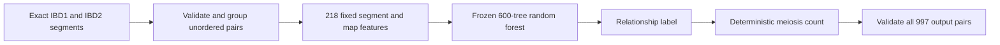

# Challenge 9 — Kevin Korfmann's method, validation, and submitted result

**Participant:** Kevin Korfmann, Synapse `ancestrum`. **Entry:** `9785353`, “Task9 ten-label RF 2026-11-20.” **Submitted release:** `2026-11-20-ten-labels`. [Overall participant report](ghist_participant_report_2026_11_20.md). This account brings together the actual method, development decisions, independent confirmation, final execution, and official scoring. It is the current narrative for Task 9; earlier readiness reports and pending-score records remain historical evidence.

Kevin's entry used a simulation-trained random forest to infer ten kinds of relationship from the exact IBD segments supplied by GHIST. The method represented each pair with 218 features describing how much DNA was shared, how sharing was distributed across segments and chromosomes, and how segment lengths changed under male and female genetic maps. The submitted model was trained on 60,266 simulated pairs and independently confirmed on another 20,023 pairs. It processed all 39,916 final-input segments and produced exactly one prediction for each of the 997 observed pairs.

The server returned **relationship weighted Jaccard 0.8337060077932977** and **meiosis-count weighted Jaccard 0.8423845484005662**. These are the competition scores, not percentages of correctly classified pairs. The entry led the three displayed submissions in earlier snapshots. At **23:39:34 Europe/Berlin on November 20, 2026**, a later entry had moved it to **second of four on both metrics**. A fresh check at **23:52:36 Europe/Berlin** confirmed the same four entries and ordering. The submitted model, predictions, and scores did not change. [Extracted exact score record](ghist_report_evidence_2026_11_20.json) · [Timestamped public snapshot](ghist_report_evidence_2026_11_20.json) · [Official leaderboard](https://www.synapse.org/Synapse:syn74803798/wiki/640981).

## What the entry did

The task supplied true identity-by-descent segments: IBD1 identifies regions where a pair shares one copy by descent, and IBD2 identifies regions where both copies are shared. The official specification restricted ancestry to the pedigree, excluded homozygous-by-descent segments, and used sex-specific maps and crossover interference. This made direct segment classification appropriate. Task 9 did not require reading genotypes, phasing them, or detecting IBD from a VCF. The map and interference references were Bhérer et al. (2017) and Campbell et al. (2015). [Official task specification](https://www.synapse.org/Synapse:syn74803798/wiki/640950) · [Recorded input contract](../experiments/readiness_2026_11_20/task9/official_input_contract.json).

The operational target was every distinct **unordered pair present in the segment CSV**. Reversing the two individual IDs did not create another pair. The workflow did not generate all combinations of the 1,894 IDs or invent absent zero-IBD pairs. The specification did not supply a separate roster for such absent pairs; the observable-pair interpretation is therefore documented as an implementation assumption. Both simulation accuracy and final coverage must be understood with that domain in mind.



This was pairwise classification. There was no family-tree reconstruction, whole-cohort structural optimization, ensemble with the Task 10–12 methods, or post-score adjustment in the submitted Task 9 pipeline. The final script called the frozen forest's probability prediction, selected its highest-probability accepted label, and mapped that label to a meiosis count. IDs were retained to join inputs and outputs; they were excluded from the model's numeric feature matrix. [Exact packaged predictor](../experiments/submission_package_2026_11_20/task9_v2/package/scripts/predict_task9_current.py) · [Feature implementation](../experiments/submission_package_2026_11_20/task9_v2/package/src/ghist_relatedness/ibd.py).

## The 218-feature representation

The representation retained information beyond total shared length. Counts and length distributions describe fragmentation; IBD2 separates sharing patterns that total IBD alone can obscure; chromosome summaries describe how sharing is distributed; and the sex-map features express each physical interval in two different recombination coordinates. These are the methodological motivations. No submitted-model ablation establishes the separate contribution of each feature group.

| Feature group | Features | Exact construction |
|---|---:|---|
| Overall sharing and counts | 13 | Total IBD1/IBD2 length, normalized sharing, IBD2 fraction, IBD1/IBD2/all segment counts, chromosomes with sharing/IBD2, start-boundary fraction, and mean/SD/maximum shared length per represented chromosome |
| IBD1 and IBD2 length distributions | 80 | For each type: seven summary statistics, 13 histogram counts, and the 20 longest segments, padded with zeros |
| Chromosome sharing distribution | 35 | 13 histogram counts of chromosome totals and 22 descending chromosome totals, padded with zeros |
| Male- and female-map distributions | 80 | For each map: seven summary statistics, 13 histogram counts, and 20 ordered segment lengths |
| Female-minus-male lengths | 7 | Mean, SD, 25th percentile, median, 75th percentile, 90th percentile, maximum |
| Map totals and ratio | 3 | Total male-map length, total female-map length, female/male total-length ratio |
| **Total** | **218** | Exact feature names and order are pinned in the release manifest |

All four segment-length distributions use the same seven summaries: mean, population SD, 25th percentile, median, 75th percentile, 90th percentile, and maximum. Histogram boundaries are **0, 2, 4, 6, 8, 10, 15, 20, 30, 40, 60, 80, 120, and infinity cM**; the features store counts. Empty groups and unavailable ordered positions are represented by zero. The 22 chromosome entries are sorted totals, rather than fixed named-chromosome slots. The start-boundary feature counts segments whose supplied starting genetic coordinate is at most 10⁻⁶ cM.

For total IBD1 length L₁, total IBD2 length L₂, and the fixed normalization G = **3,350.933402 cM**, the feature called `relatedness` is `(0.5 × L₁ + L₂) / G`. The IBD2 share is `L₂ / max(L₁ + L₂, 10⁻⁹)`. Male and female segment lengths are obtained by separately interpolating both physical endpoints on the frozen map and subtracting their mapped positions. The forest consumes these fixed numeric features without a learned feature-scaling stage. [Pinned feature source](../experiments/submission_package_2026_11_20/task9_v2/package/src/ghist_relatedness/ibd.py) · [Complete ordered feature list](../experiments/submission_package_2026_11_20/task9_v2/package/configs/task9_current_release.json).

## Training and the decisions that led to the submitted model

The historical method selected a random forest using simulation-level validation, with six training replicates, a separate selection replicate, and a further evaluation replicate. Its twelve-label evaluation reported 82.34% exact accuracy and 85.35% meiosis accuracy. Those historical numbers concern a different label contract and dataset; comparing them directly with the later ten-label confirmation would exaggerate improvement. The historical testing prediction contained 989 pairs; the submitted final prediction contained 997. [Historical freeze](../experiments/ibd_segments/task9_freeze.json).

A more complex degree-factorized histogram-gradient/forest blend was investigated and rejected. Its four primary holdout replicates showed a mean exact-accuracy gain of about 0.109 percentage points, failing the primary gate. Four further confirmation replicates showed only about 0.002 percentage points of mean gain, with two positive replicates and a decrease in meiosis accuracy. The preserved decision was to retain the forest. This negative comparison is part of the development history, rather than evidence that the final entry used the blend. [Rejected alternative](../experiments/ibd_segments/task9_degree_factorized_screen.json).

The decisive November repair addressed **label support**. The historical forest contained `half_sibling` and `half_2nd_cousin`, which were absent from the current ten-label contract. Simply discarding those classes and renormalizing the remaining probabilities could fail: some valid input pairs received zero total probability across all accepted classes. Three unperturbed Poisson diagnostic pairs exposed the problem; map-length perturbations exposed further failures. The strict predictor rejected those cases instead of silently inventing a fallback label.

The repair refitted a clone of the historical forest on the **original calibration replicates 0–5**, retaining only the ten accepted classes. It kept the forest settings fixed and did not search against the new diagnostic or confirmation outcomes. The resulting training set contained **60,266 pairs**. “Calibration” here means training simulations; it does not mean that the forest probabilities were calibrated. [Scientific review](scientific_relatedness_2026_11_20.md) · [Refit script](../scripts/train_task9_current_candidate.py) · [Training record](../experiments/submission_package_2026_11_20/task9_v2/package/experiments/scientific_2026_11_20/relatedness/task9_current_training.json).

| Setting | Submitted value |
|---|---|
| Classifier | scikit-learn `RandomForestClassifier` |
| Trees | 600 |
| Split criterion | Gini |
| Bootstrap sampling | Enabled |
| Class weighting | `balanced_subsample` |
| Features available per split | `max_features=0.8` |
| Minimum leaf size | 2 |
| Minimum split size | 2 |
| Maximum depth | Unlimited (`None`) |
| Model random seed | 90926 |
| Training / final prediction workers | 4 / 2 |
| Input dimension / classes | 218 / 10 |

The training record binds each calibration file by SHA-256 and records the baseline-model hash. Two confirmation simulations were generated after the refit was fixed. The submitted release had nonzero accepted-class probability support throughout their nominal and map-stress runs. Its accuracy was essentially unchanged from the historical forest evaluated under the same current-label conditions: the support repair improved operational validity, without demonstrating a large biological accuracy gain.

## Independent confirmation and observed weaknesses

Ped-sim generated exact segments with the fixed pedigree templates and sex-specific map. The matched scenario used crossover interference; the shifted scenario used Poisson crossovers. Ped-sim supports direct IBD simulation without genotype data, which matches the supplied Task 9 input type. [Ped-sim implementation](https://github.com/williamslab/ped-sim) · [Executed confirmation script](../experiments/scientific_2026_11_20/relatedness/confirmation.sbatch).

| Untouched confirmation | Seed | Observed pairs | Independent pedigrees | Exact-label accuracy | Balanced accuracy | Meiosis accuracy | Pedigree-bootstrap 95% interval for exact accuracy |
|---|---:|---:|---:|---:|---:|---:|---|
| Matched interference | 2026112307 | 10,038 | 9,038 | 89.10% | 83.35% | 89.41% | 88.45–89.70% |
| Poisson crossover shift | 2026112308 | 9,985 | 8,985 | 87.20% | 81.48% | 87.71% | 86.53–87.87% |

Exact accuracy counts correct labels; balanced accuracy averages recall equally across labels; meiosis accuracy compares the mapped counts. Each simulation had 11,000 expected accepted-label pairs before zero-IBD omission. Consequently, 962 and 1,015 pairs, respectively, were outside the observed-IBD evaluation. Multiple pairs from the same pedigree were resampled together in the bootstrap. The intervals describe inheritance sampling for these fixed template mixtures, not uncertainty over all possible pedigree structures or real populations. [Matched confirmation](../experiments/submission_package_2026_11_20/task9_v2/package/experiments/scientific_2026_11_20/relatedness/task9_confirmation_current_interference.json) · [Shifted confirmation](../experiments/submission_package_2026_11_20/task9_v2/package/experiments/scientific_2026_11_20/relatedness/task9_confirmation_current_poisson.json).

The frozen release thresholds required at least 10,000 matched pairs, 80% exact accuracy, 75% balanced accuracy, and 84% meiosis accuracy. The matched confirmation met the sample requirement; both scenarios exceeded all three numerical accuracy thresholds. Fixed ±10% segment/map-length perturbations also retained valid probability support. These perturbations scale measured genetic lengths while keeping the genome normalization fixed; they are a measurement-scale stress, not independently generated maps. Exact accuracy under the −10%/+10% stresses was 88.04%/88.87% for interference and 85.68%/87.03% for Poisson. Those repeated measurements do not increase the number of independent simulation datasets.

| Relationship | Matched recall | Poisson-shift recall | Meioses assigned | Final predicted pairs |
|---|---:|---:|---:|---:|
| `siblings` | 100.00% | 99.90% | 2 | 100 |
| `grandparent_grandchild` | 100.00% | 99.10% | 2 | 200 |
| `avuncular` | 99.70% | 98.80% | 3 | 101 |
| `double_cousin` | 100.00% | 100.00% | 4 | 100 |
| `full_1st_cousin` | 97.80% | 97.40% | 4 | 99 |
| `half_1st_cousin` | 85.80% | 80.20% | 4 | 105 |
| `full_2nd_cousin` | 83.80% | 77.60% | 6 | 96 |
| `full_3rd_cousin` | 75.83% | 70.07% | 8 | 89 |
| `full_4th_cousin` | 56.66% | 55.63% | 10 | 74 |
| `full_5th_cousin` | 33.87% | 36.07% | 12 | 33 |
| **Final output total** | — | — | — | **997** |

The last column counts **predictions**, not final truth or correct predictions. Its relatively small distant-cousin counts cannot establish the final class prevalence. The recall columns show that fourth- and fifth-cousin identification remained a major weakness. Different relationships can also share a meiosis count, so a correct count does not imply a correct relationship label. Class probabilities remained uncalibrated; a high forest probability was not reported as a validated posterior probability. [Rechecked evidence and label counts](ghist_report_evidence_2026_11_20.json).

## Checking the complete prediction path

The production predictor was exercised on anonymized simulation CSVs and independently recorded expected-pair lists. The workflow then invoked the submission-validator CLI separately. Reversing pair orientation, permuting segment rows and CSV columns, and adding a UTF-8 byte-order mark preserved the pair-to-label results. This both checked format robustness and avoided relying on relationship labels embedded in simulation identifiers.

Eight production executions across the unversioned and explicit-release paths reproduced the fixed confirmation scores for the same **20,023 distinct pairs**. A later compatibility run executed four more cases and produced byte-identical prediction CSVs; it reused those pairs. The v2 handoff package also passed runtime/model/map preflight. The contemporaneous reports record 54 targeted tests for the operational release and 67 tests for the v2 handoff; these are historical test results, not newly rerun tests or extra biological confirmation. [Operational release report](task9_readiness_2026_11_20.md) · [V2 handoff and test scope](task9_submission_handoff_2026_11_20.md).

The final package pins model identity, accepted labels, feature order, feature/label source, genetic map, runtime, and compact validation evidence. It checks raw-input pair coverage before feature extraction and requires final-input entity/version/checksum provenance. Duplicate segments, reversed duplicates, malformed or nonfinite fields, inconsistent lengths, unsupported HBD, absent map chromosomes, and pair-coverage mismatches are rejected. A validated CSV replaces an existing predictor output only after checks succeed; the handoff wrapper uses a fresh run directory.

Those checks have explicit limits. The frozen feature implementation permits fractional physical coordinates, zero-length segments, and overlaps. NumPy interpolation clamps physical endpoints beyond the map range rather than rejecting them. Format checks and hashes establish consistency; they do not certify biological correctness, authenticate externally supplied metadata on their own, or establish prediction accuracy. [Packaged release checks](../experiments/submission_package_2026_11_20/task9_v2/package/src/ghist_relatedness/task9_release.py) · [Handoff wrapper](../experiments/submission_package_2026_11_20/task9_v2/package/scripts/prepare_task9_submission_package.py).

## The actual final run and submission

The downloaded final file was **Synapse `syn75202631`, version 3**, with 39,916 segments. Its entity/version and MD5 were observed through the authenticated Synapse interface and recorded separately from the local SHA-256. The pinned v2 package ran on Betty in **Slurm job 10856122**, using two CPUs and taking **23 seconds elapsed** for the recorded job. This duration is the final job duration, not the cost of training or the entire development process.

The final output contained 997 unique unordered pairs spanning 1,894 individual IDs, with the exact columns `indID1,indID2,meioses_count,relation`. Raw-input pairs, the expected-pair file, and predicted pairs agreed exactly. All ten accepted labels appeared, and every meiosis value agreed with its deterministic label mapping. Accepted-label filtering changed **zero** of the model's raw argmax predictions. The independent coordinator audit rehashed ten run files before upload. [Recorded final-run identity](ghist_report_evidence_2026_11_20.json) · [Prediction summary](ghist_report_evidence_2026_11_20.json) · [Independent final audit](ghist_report_evidence_2026_11_20.json).

| Record | Identity |
|---|---|
| Input | `syn75202631`, version 3; `relatedness1.final.csv` |
| Input SHA-256 | `ff7031bc00a96f7d38131e010f1168f95fb4a8efad5849c904b2d7e77e4de394` |
| Frozen model SHA-256 | `7fc54aa5f0dff1d8dc01364cf781d7a750970e1558a525c2fbdebcbc04a0611c` |
| Genetic-map SHA-256 | `e5cf4af7f914f9d675c3e3c5d7648775aefd456710dcab826195148ee7aadae1` |
| Package-manifest SHA-256 | `4c0ec8f9ae12b00b77506b803812c3378f1d43bf873ff206a1db2bffeca5da9e` |
| Submitted CSV SHA-256 | `d2810e81b74591c3d10c5305643c3ed4494ab416e44e4f98c37ff6df92b16c6d` |
| Uploaded entity | [`syn78778815`](https://www.synapse.org/Synapse:syn78778815), version 1 |
| Evaluation | `9619673`, GHIST 2026 Relatedness 1 Final |
| Submission | `9785353`, individual participation as `ancestrum` |
| Score email received | November 20, 2026, **20:19:21 Europe/Berlin** (19:19:21 UTC) |
| Final recorded status | `SCORED` |

The receipt binds the uploaded entity, submission ID, exact score email, and local candidate hash. It records no post-score model or prediction changes. Older artifacts legitimately say “not submitted” or “scoring pending” because they capture earlier stages. They are preserved; the later scored receipt supplies the completion record. [Extracted submission receipt](ghist_report_evidence_2026_11_20.json) · [Submitted CSV identity and hash](ghist_report_evidence_2026_11_20.json).

## Official result and how to describe it

The published relatedness score is a true-class-size-weighted mean of classwise Jaccard values: for class k, `J_k = TP_k / (TP_k + FN_k + FP_k)`, weighted by `N_k = TP_k + FN_k`, then divided by the total true count. The relationship field and the meiosis field are scored separately. Thus **0.833706 is not evidence that 83.3706% of final pairs were labeled correctly**; final ordinary accuracy and a final classwise confusion matrix are not established by the retained score receipt. [Scoring formula and retained provenance](ghist_report_evidence_2026_11_20.json) · [Official scoring page](https://www.synapse.org/Synapse:syn74803798/wiki/640739).

| Standing rechecked at 23:52:36 Europe/Berlin | Participant | Relationship score, displayed | Meiosis score, displayed |
|---:|---|---:|---:|
| 1 | austin.t.daigle | 0.838 | 0.849 |
| **2** | **ancestrum — Kevin Korfmann** | **0.834** | **0.842** |
| 3 | paiksca | 0.828 | 0.840 |
| 4 | rgollnisch | 0.822 | 0.827 |

Ranks use the same displayed precision for all participants. Kevin's exact server scores are given above; competitors' hidden precision is unavailable. The displayed gaps to the new leader are 0.004 for relationship and 0.007 for meioses. The earlier three-entry snapshot had Kevin first on both; the new leader's row is timestamped 23:30 on November 20. These observations occurred before the competition deadline and do not establish the final closed ranking. [Earlier snapshot](ghist_report_evidence_2026_11_20.json) · [Later snapshot](ghist_report_evidence_2026_11_20.json).

Kevin also submitted successfully to **all fourteen challenges**. The earlier overall table's “12 entered” referred to entries within the twelve displayed leaderboards, not his total participation. Challenges 13 and 14 have valid RRMSE scores of **0.6172118592711575** and **0.042643298573969445**, respectively. Their competitor counts remain unverified: the public demographic page lists the tasks, the demographic dashboard index has no content, and anonymous access to both final evaluation queues returned HTTP 403. Missing standings do not establish that no competitor submitted. **For the requested wins-based ranking, a sole valid entry counts as a win** once sole-entry status is verified; it receives no discount for lack of competitors. The latest Task 9 snapshot supersedes the earlier claim of a current Task 9 win. The linked overall report recalculates the wins table from the refreshed twelve boards. [All-task scores and participant ranking](ghist_participant_report_2026_11_20.md) · [Low-coverage standings check](ghist_report_evidence_2026_11_20.json).

## What can be reproduced from the retained record

The documentation audit rehashed all **16 package files** and all **10 final-run files**, checked the package against the final handoff's recorded hash, recounted the segments/pairs/IDs and label assignments, linked the scored receipt to the exact candidate and email evidence, and confirmed fourteen distinct scored submission IDs. It also checked the training/confirmation/model identity links and the saved leaderboard rank. It did not rerun the forest, retrieve final truth, or turn stored validation scores into new independent evidence. [Audit results](ghist_report_evidence_2026_11_20.json) · [Local audit record](ghist_report_evidence_2026_11_20.json).

The validated inference runtime was Linux x86_64, Python **3.11.11**, scikit-learn **1.9.0**, NumPy **2.4.6**, SciPy **1.16.3**, joblib **1.5.3**, threadpoolctl **3.6.0**, and PyYAML **6.0.3**. Use the dedicated release requirements instead of synchronizing the general repository lock, which describes a different environment. The package contains prediction and validation code plus compact evidence; the large model and map remain external artifacts. A clean new environment has not been independently rescored. [Runtime preflight](ghist_report_evidence_2026_11_20.json) · [Pinned requirements](../requirements/task9-release-2026-11-20.txt).

To inspect the completed inference, consult the [Slurm run summary](ghist_report_evidence_2026_11_20.json) and [recorded final-run identity](ghist_report_evidence_2026_11_20.json). The model is located under `artifacts/task9_releases/2026-11-20-ten-labels/model.joblib` relative to the externally retained artifact root (`TASK_ROOT`); the map is `external/ped-sim-map/refined_mf.simmap`. The wrapper invocation is:

```bash
"$TASK_PYTHON" "$TASK_PACKAGE/scripts/prepare_task9_submission_package.py" run \
  --package "$TASK_PACKAGE" --artifact-root "$TASK_ROOT" \
  --sex-map "$TASK_ROOT/external/ped-sim-map/refined_mf.simmap" \
  --observed "$TASK_INPUT" --input-provenance "$TASK_PROVENANCE" \
  --run-dir "$TASK_NEW_RUN" --workers 2 \
  --expected-package-sha256 4c0ec8f9ae12b00b77506b803812c3378f1d43bf873ff206a1db2bffeca5da9e
```

Here `TASK_PYTHON` is the isolated pinned interpreter, `TASK_PACKAGE` is the verified v2 source package, `TASK_ROOT` contains the externally retained model/map, `TASK_INPUT` and `TASK_PROVENANCE` refer to the recorded version-3 input and its provenance JSON, and `TASK_NEW_RUN` must be a fresh destination. This is a reproduction recipe, not a request to rerun or resubmit the challenge. Reconstructing training additionally requires the six recorded calibration files, the historical baseline model, and the training/generation sources. The offline inference package alone is not a complete retraining archive. The original Ped-sim executable/build and simulation files were not freshly reverified for this documentation pass.

## Interpretation and contribution

The entry's documented strengths are its direct match to the exact-segment task, a rich but fixed pair representation, an explicit repair of a real accepted-label failure, independent seed/crossover confirmation, and checks connecting the validated model to the exact submitted CSV. The record also shows a rejected complex alternative, retained distant-cousin errors, and an honest separation between operational validation, simulation performance, and the official competition result. The evidence does not identify which individual feature caused the competitive result or establish a novel classifier algorithm.

Transfer remains limited to what was tested: fixed pedigree templates, pairs with observed IBD, exact segments, and the specified crossover/map stresses. The study does not establish performance for novel pedigree topology, zero-IBD pairs, phasing or IBD-detection errors, HBD, background ancestral sharing, or full-pedigree reconstruction. A leaderboard lead or second place is a relative result on the challenge, not a substitute for those evaluations.

Kevin Korfmann is the named participant and directed this work. AI agents assisted with analysis, implementation, execution, validation, review, and documentation under his direction, as recorded in the competition methods statement. This account describes his entry and its development without attributing every agent-executed action to manual work by Kevin. This GitHub report documents the completed entry; the submitted predictions remain unchanged. .

The accompanying [evidence extract](ghist_report_evidence_2026_11_20.json) includes the local audit, exact scored-submission fields, refreshed rendered tables, per-task ranks, and retained source hashes. Links to excerpts are labeled as records or summaries; the full local execution archive is not reproduced in this report.
