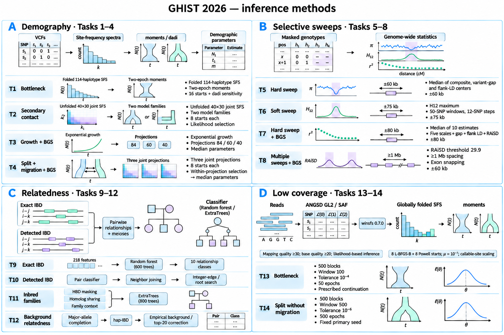

# GHIST 2026 methods schematic

The four panels cover the final inference procedures for all fourteen tasks. The visual style follows Kevin Korfmann’s annual-review figures: blue panel letters, thin pale-blue dividers, a white background, and blue, teal and lavender genomic illustrations.

**A — Demography.** VCF-derived frequency spectra feed task-specific moments/dadi models. Each row identifies the primary model, projection and selection rule.

**B — Selective sweeps.** Masked genotype scans produce fixed-width candidate intervals. The rows distinguish composite/gap/LD localization, H12, multiscale consensus with RAiSD, and thresholded RAiSD candidates.

**C — Relatedness.** Exact IBD segments and detected IBD have different inputs and classifiers. The task rows show the random forest, structural decoding, context ExtraTrees, and empirical background correction.

**D — Low coverage.** ANGSD genotype likelihoods and site-allele-frequency likelihoods feed winsfs spectra and moments fitting. The rows specify block/window settings, optimizer starts, epoch limits and selection policy.

Abbreviations: SFS, site-frequency spectrum; BGS, background selection; LD, linkage disequilibrium; IBD, identity by descent; HBD, homozygosity by descent; SAF, site-allele-frequency likelihood; GL2, ANGSD’s selected genotype-likelihood model. Interval widths are method choices. Diagrams illustrate the procedures rather than measured results.

Generation: built-in imagegen, followed by visual and task-by-task text checks against the submitted methods writeup. The figure contains no footer slogans or status statements.
